<p align="center">
  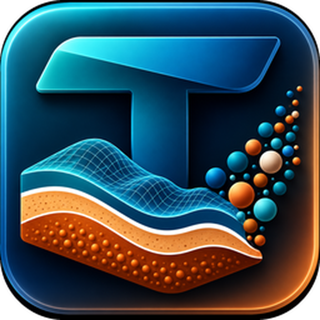
</p>

# Tellus 2D: download and licence

Tellus is a plane-strain geotechnical finite element program for engineers. It builds and
calculates excavations, embankments, slopes and foundations with staged construction,
consolidation and safety analysis, and its chat assistant can build a model from a
description in English or Thai. This repository holds the ready-built program for macOS,
Windows and Linux. Without a licence key it runs as the free academic edition, which is meant for
teaching and learning and calculates small models, whereas a licence key, activated once on
each computer, lifts every limit.

**Quick start.** Download the program for your system from the [Download](#download)
section and start it. Choose **Continue with the free academic edition** to use it at once
without a key, or paste a licence key from [tellusfem@gmail.com](mailto:tellusfem@gmail.com)
into the activation screen. Activation needs the internet once, and after that Tellus runs
on your computer like any desktop program.

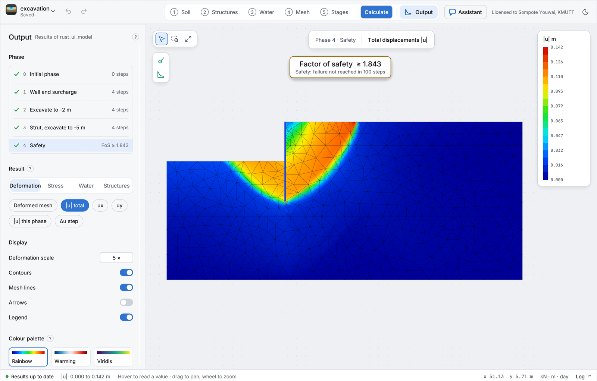

## What Tellus does

Tellus covers the everyday finite element work of a geotechnical engineer in one program,
and it runs entirely on your own computer, so a calculation needs no other FE software
or network service once the licence is active. You build a model in five numbered steps,
calculate it with the built-in solver and read the results in **Output**, whereas the
**Assistant** can do the same steps from a description in words. The same model can also
be driven by AI assistants such as Claude and ChatGPT through Tellus's MCP server
([Step 4](#step-4-optional-connect-claude-or-chatgpt-through-mcp)), so an assistant and an
engineer can work on one project file.

**The window in 0.1.4.** Tellus opens on a **Home** page, where a model starts from a soil
profile, from drawn geometry or from a description for the assistant, and where recent
projects reopen. A bar across the top then leads through the work: **1 Soil**,
**2 Structures**, **3 Water**, **4 Mesh** and **5 Stages**, followed by **Calculate**,
**Output** and **Assistant**. Each step has its own panel on the left and a **Next** button
to the following step, the project name opens the file menu, two arrows undo and redo any
edit, and the window has a light and a dark theme.

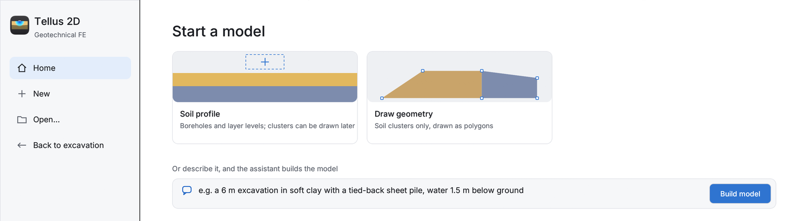

| Step | What you define |
|---|---|
| 1 Soil | Model width, boreholes and layer levels, soil clusters, soil materials |
| 2 Structures | Supports, plates, anchors, struts, embedded piles, geogrids, loads, fixities |
| 3 Water | Water levels and which boundaries drain |
| 4 Mesh | Element size, triangles or a structured mesh, local refinement, mesh quality |
| 5 Stages | The phases: type, soil and structures in place, loads and water |

**Modelling.** The soil comes from one or more boreholes, which give sloping strata between
them, or from soil polygons drawn with the mouse for embankments and irregular ground.
Anything in the drawing can be picked to edit its properties, and a material dialog holds
the soils and the plate, anchor, pile and geogrid materials.

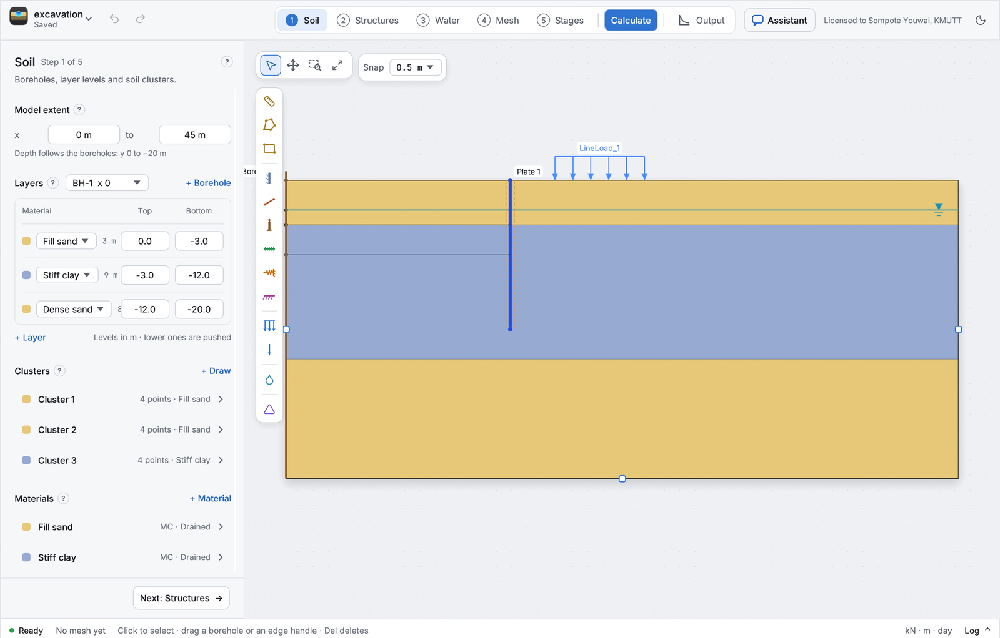

**Soil models.** Tellus offers linear elastic, Mohr-Coulomb with drained and Undrained A, B
and C behaviour, Hardening Soil and HS small for stiffness that depends on stress and
strain, Soft Soil and Soft Soil Creep for soft clays, and a hypoplastic model for sand
that follows its density.

**Structures and loads.** Plates model walls and sheet piles, either elastic or
elastoplastic with plastic hinges, with interfaces on either side. Spring supports model
struts and anchors, geogrids model reinforcement, and embedded piles carry load by skin
friction and base resistance. Line and point loads complete the model.

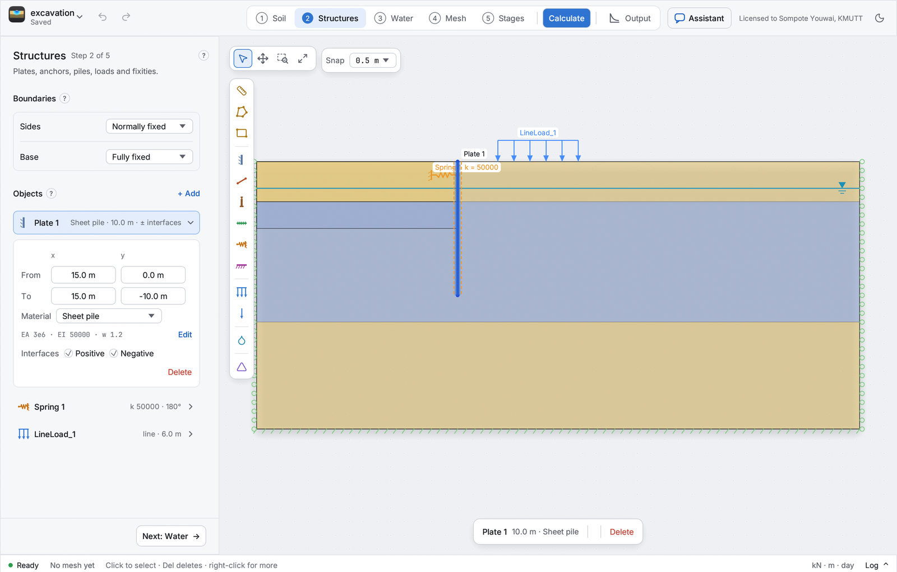

**Construction stages and groundwater.** Each phase can excavate or place soil, switch
structures and loads on or off, and change the water. Phases are plastic, consolidation
or Safety (φ-c reduction), and the initial stresses come from the K0 procedure or gravity
loading. Groundwater is set per phase as phreatic levels or as steady-state flow, with
the drainage of each model side chosen for flow and consolidation.

**Mesh and solver.** The mesh uses 15-node triangles, or structured 25-node rectangles,
with local refinement, and the Mesh step reports the element count and the mesh quality.
The solver was checked against analytical solutions, a reference FE code and published
examples.

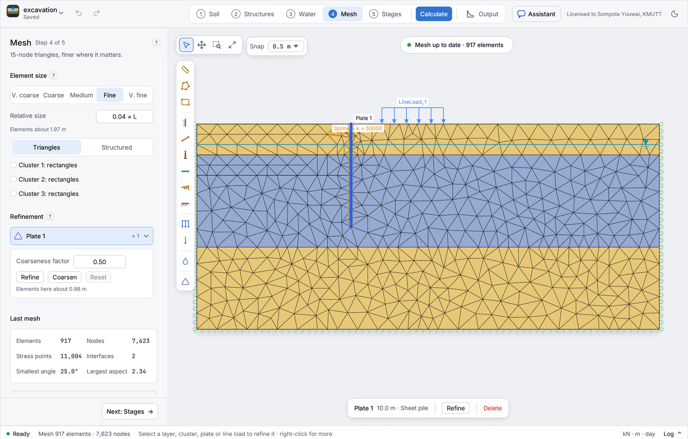

**Results.** Output plots any phase as a deformed mesh or as contours of displacement,
stress and pore pressure, in a Rainbow, Warming or Viridis palette, and hovering the plot
reads the values. Plates show axial force, shear force and bending moment diagrams along
their length, and the log gives the forces in struts, geogrids and piles. A Safety phase
reports its factor of safety ΣMsf, while the displacements show the failure mechanism. The
Curves window plots displacement or excess pore pressure at picked points against step,
time or ΣMsf, for example settlement against time during consolidation, and copies the
data for a spreadsheet.

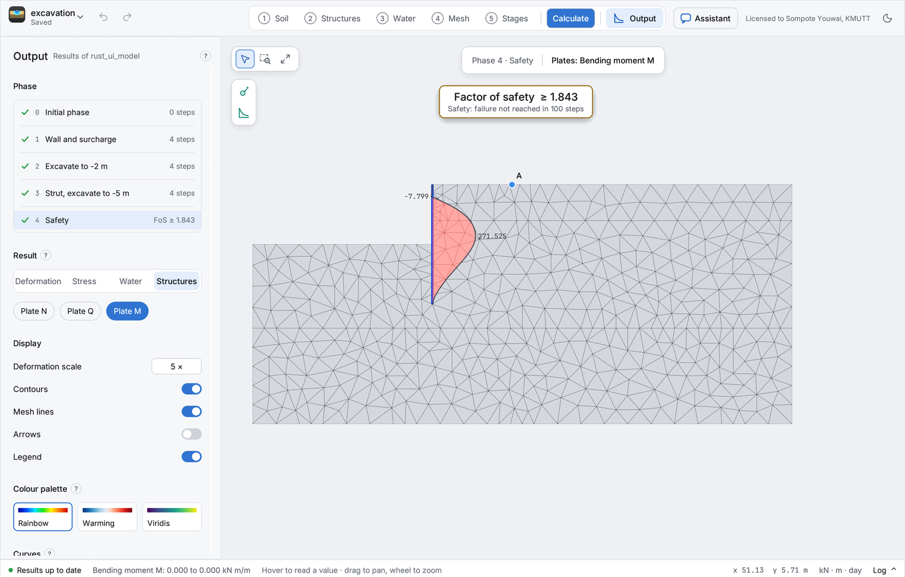

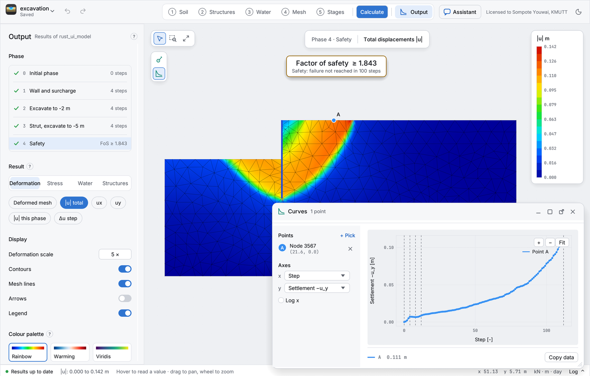

**Assistant.** The Assistant opens beside the model, so the model stays in view
while you describe a problem, for example "a 3 m wide strip footing on 5 m of dense sand
over stiff clay carries 150 kPa, the water table is 2 m down; what is the settlement and
the factor of safety?". Tellus then builds the model, calculates it and answers with the
solver's numbers. Every change goes into the model on screen as an ordinary edit, so you
can check, correct and undo it. The assistant works in Thai as well as English, and it can
write a PDF report with pictures of the results. It has two engines: **Jev**, which is
fast and lets Tellus code choose from a fixed set of actions, and the **TigrimOS agent**,
an LLM agent that plans its own steps with all of Tellus's tools. Each engine needs its
own API key, which you enter under **Settings** in the chat panel, and this key is
separate from the Tellus licence. [Step 3](#step-3-optional-set-up-the-chat-agent) explains
how to set up the agent.

**Files.** Projects are saved as small `.tellus` files, a few kB each, because the results
are recalculated rather than stored. Tellus can also read PLAXIS 2D results files
(`.p2dx`) and export a model as PLAXIS 2D commands.

## Download

| System | File | Notes |
|---|---|---|
| macOS 11 or later, Intel or Apple Silicon | [`macos/Tellus-0.1.4-macos-universal.dmg`](macos/Tellus-0.1.4-macos-universal.dmg) | Open the DMG and drag **Tellus** into **Applications**. |
| Windows 10 or 11, 64-bit | [`windows/Tellus-0.1.4-windows-x64.zip`](windows/Tellus-0.1.4-windows-x64.zip) | Unzip the folder anywhere and run `Tellus.exe`. Keep `tigrim.exe` beside it, because the chat assistant uses it. |
| Linux, 64-bit (x86-64), glibc 2.31 or later: Ubuntu 20.04, Debian 11, Fedora 32 and later | [`linux/Tellus-0.1.4-linux-x64.tar.gz`](linux/Tellus-0.1.4-linux-x64.tar.gz) | Unpack it and run `./tellus`. Keep `tigrim` beside it. See the Linux notes below. |

The current version is 0.1.4.

| Version | What changed |
|---|---|
| 0.1.4 | Redesigned window: Home page, five numbered steps with their own panels, Calculate and Output in the top bar, a floating calculation card, the Curves window and colour palettes in Output. New app icon. First Linux build. Fixes to interfaces and embedded piles. Without a key, every start asks for a key or the free academic edition |
| 0.1.3 | A plate along the edge of a soil cluster meshes correctly at every element size. The free edition refuses a mesh above its limit when the mesh is generated |
| 0.1.2 | The free academic edition, which runs without a key |

**User manual.** [`docs/Tellus2D_user_manual.pdf`](docs/Tellus2D_user_manual.pdf) (62 pages)
explains the installation, the licence key and the assistant's API key, the window step by
step on a strutted excavation, the use through MCP with Claude Code and with TellusHive,
structures, water and mesh, and the cases the program is calibrated on. It was written
with the development version of 12 November 2026, so a few things it describes are not in
0.1.4 yet: dynamic analysis (Chapter 8), the updated mesh option, and calculation on a
cloud GPU.

**Linux notes.** Unpack the archive with `tar xzf Tellus-0.1.4-linux-x64.tar.gz` and start
`./tellus` in the folder. Tellus needs a desktop with OpenGL, and on a minimal system the
usual desktop libraries, which on Ubuntu or Debian are installed with
`sudo apt install libgl1 libegl1 libxkbcommon-x11-0 libxcursor1 libxi6 libxrandr2 ca-certificates`.
The archive also holds an icon and a `tellus.desktop` entry for the applications menu, and
its `README.txt` explains where to copy them. The Linux build is new in 0.1.4 and has been
tested on Ubuntu 22.04 only, so please report any problem. It is protected by the same
licence key as the other systems: without a key it runs as the free academic edition, and
`./tellus --activate <key>` or the start screen activates it.

The programs are not signed by a registered developer, so the system warns you the first
time. On macOS, right-click **Tellus** in Applications, choose **Open**, and confirm with
**Open**. On Windows, choose **More info** and then **Run anyway** when SmartScreen
appears. Tellus needs about 90 MB of disk, and 4 GB of memory is enough for ordinary
models, whereas 8 GB is comfortable for fine meshes.

## The free academic edition

Tellus needs no key for teaching and learning. At the first start click **Continue with
the free academic edition**, which Tellus offers at every start until a key is entered.
The free edition needs no internet, and it calculates any model that stays within these
limits, which are enough for the footing, slope, retaining wall and embankment problems of
a soil mechanics or foundation engineering course:

| Item | Free academic edition | With a licence key |
|---|---|---|
| Mesh | up to 1,000 elements | no limit |
| Phases | the initial phase and 2 more | no limit |
| Soil models | Linear elastic, Mohr-Coulomb, Soft Soil | also Hardening Soil, HS small, Soft Soil Creep, hypoplastic sand |
| Structures | up to 2 plates, 2 geogrids and 2 struts or anchors, no embedded piles | no limit |
| PLAXIS export | no | yes |
| Reports and result plots | watermarked "not for commercial use" | no watermark |

A model beyond a limit is still built and saved, but Tellus explains which limit stops the
calculation, and the same rule applies to the chat assistant and to the MCP server. The
top bar shows **Free academic edition**, and clicking it lists the limits and takes a
licence key, so you can activate later without restarting. The free edition is for
teaching, learning and student exercises only, not for design or other commercial work.

## Step 1: get a licence key

Ask for a key by e-mail to **[tellusfem@gmail.com](mailto:tellusfem@gmail.com)** and give
these details, because the key is issued in your name and limited to a number of
computers:

- your full name,
- your affiliation (university or company),
- your e-mail address,
- how many computers will run Tellus,
- the plan you need: academic (free research keys for staff and thesis students, from a
  university e-mail address), trial or standard.

The [contact form on the Tellus website](https://tellusfem.github.io/#contact) sends the
same request.

You will receive a key of the form `TLS-XXXX-XXXX-XXXX-XXXX-XXXX`. Keep it private,
because anyone with the key could use one of your seats.

## Step 2: activate Tellus

Start Tellus while connected to the internet. The first screen asks for the key, so paste
it into the box and click **Activate**. Upper or lower case and spaces do not matter.

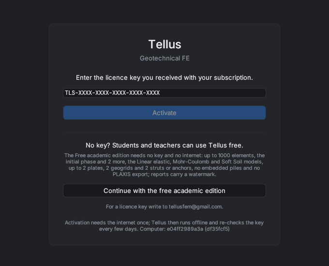

Tellus checks the key with the licence server and opens the normal workspace. The top bar
then shows who the copy is licensed to, which confirms that activation worked.

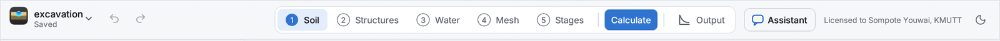

## Step 3 (optional): set up the chat agent

The assistant is optional, because every model can also be built by hand in the five steps.
We recommend the **TigrimOS agent** with a model from **OpenRouter**, a service that gives
one API key for many AI models and charges per use. Its recommended model is
**DeepSeek V4.1 Flash** (`deepseek/deepseek-v4.1-flash-1017`), the model Tellus was tested
with, which is fast and cheap, at US$0.15 per million input tokens and US$0.60 per
million output tokens (OpenRouter's prices on 18 October 2026). Payment for the model
goes to OpenRouter and is separate from the Tellus subscription.

**Get an OpenRouter key.**

1. Sign up at [openrouter.ai](https://openrouter.ai) with an e-mail, Google or GitHub
   account.
2. Add credit under **Settings → Credits**, because paid models need a balance. A few
   dollars lasts a long time with this model.
3. Open [openrouter.ai/keys](https://openrouter.ai/keys), click **Create Key**, give it a
   name such as "Tellus", and copy the key, which starts with `sk-or-v1-`. OpenRouter
   shows it only once, so paste it into Tellus straight away or keep it somewhere safe.

**Enter it in Tellus.**

1. Click **Assistant** at the top right, choose **TigrimOS agent** in the list next to
   **Assistant**, and click **Settings**.
2. Leave **tigrim** empty, because Tellus finds the agent program that comes with it.
3. Fill in the three fields:

   | Field | Value |
   |---|---|
   | API URL | `https://openrouter.ai/api/v1` |
   | Model | `deepseek/deepseek-v4.1-flash-1017` |
   | API key | your OpenRouter key (`sk-or-v1-…`) |

4. Click **Save key** and then **Done**. The key stays on your computer, in your user
   settings folder, and Tellus gives it only to the agent.

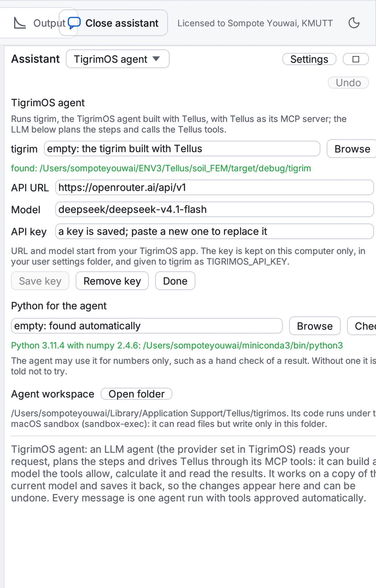

**Python for the agent** is optional. When Python with numpy is installed, Tellus finds it
and the agent may use it for numbers, such as a hand check of a result, and without it the
agent still works. The **Agent workspace** is the only folder the agent may write to, and
on macOS its code runs in the system sandbox.

Now describe a problem in the chat, for example "a 3 m wide strip footing on 5 m of dense
sand over stiff clay carries 150 kPa, the water table is 2 m down; what is the settlement
and the factor of safety?". The agent builds the model on screen, calculates it and
answers with the solver's numbers, and each of its changes can be checked and undone.
Other OpenRouter models also work, as do other providers with an OpenAI-compatible API,
when you change the URL and the model. The model must support tool calling, and a weak
model makes more mistakes in building the model, so check its results as you would a
junior engineer's.

## Step 4 (optional): connect Claude or ChatGPT through MCP

**Give your assistant the briefing file.** [`agent_info.md`](agent_info.md) tells an AI
agent how to work with Tellus: the units and conventions, the workflow and the tools, the
mistakes to avoid, how to report results, the limits of the free academic edition, and how
to run an analysis on a remote Linux computer over SSH. Attach it to your first message, or
tell Claude Code "read agent_info.md before you use Tellus".

Tellus can also be driven from an AI assistant outside the program, such as Claude Desktop,
Claude Code, the ChatGPT desktop app or Codex, through the Model Context Protocol (MCP).
The command `tellus --mcp` starts Tellus without a window as an MCP server that the
assistant launches on your computer and talks to over stdin and stdout. It gives the
assistant 29 tools to build a model, calculate it and read the results, so a request such as
"model a 2 m strip footing on 4 m of sand over soft clay, apply 80 kPa, and give me the
settlement and the factor of safety" is answered with the solver's numbers. The server uses
the same licence as the program, so it has the limits of the free academic edition until
the computer is activated ([Step 2](#step-2-activate-tellus)), and it works on ordinary `.tellus` files, so a project the assistant saves opens in Tellus
for checking.

Each assistant needs the full path of the Tellus program:

| System | Path of the program |
|---|---|
| macOS | `/Applications/Tellus.app/Contents/MacOS/tellus` |
| Windows | the full path of `Tellus.exe`, for example `C:\Tools\Tellus\Tellus.exe` (written `C:\\Tools\\Tellus\\Tellus.exe` inside JSON) |

**Claude Desktop.** Open **Settings → Developer → Edit Config**, which opens
`claude_desktop_config.json` (in `~/Library/Application Support/Claude` on macOS and
`%APPDATA%\Claude` on Windows). Add Tellus under `mcpServers`, save the file and restart
Claude Desktop:

```json
{
  "mcpServers": {
    "tellus": {
      "command": "/Applications/Tellus.app/Contents/MacOS/tellus",
      "args": ["--mcp"]
    }
  }
}
```

The Tellus tools then appear under the tools button in a new chat, and Claude asks before it
uses each one unless you allow it for the conversation.

**Claude Code.** Register the server once for your user account, and the tools load in
the next session, where `/mcp` lists them:

```sh
claude mcp add -s user tellus -- /Applications/Tellus.app/Contents/MacOS/tellus --mcp
```

**ChatGPT desktop app and Codex.** The ChatGPT desktop app, the Codex command line and the
Codex IDE extension start local MCP servers from one shared file, `~/.codex/config.toml`
(`%USERPROFILE%\.codex\config.toml` on Windows). Add Tellus with one command,

```sh
codex mcp add tellus -- /Applications/Tellus.app/Contents/MacOS/tellus --mcp
```

or write the entry into the file by hand:

```toml
[mcp_servers.tellus]
command = "/Applications/Tellus.app/Contents/MacOS/tellus"
args = ["--mcp"]
```

`codex mcp list` shows the server, `/mcp` lists it inside Codex, and the desktop app shows
it under **Settings → MCP servers**. ChatGPT in the web browser and on the phone is
different, because it reaches MCP servers only over HTTPS on the internet and cannot start a
program on your computer. Tellus has no web server of its own, so use the desktop app or
Codex. OpenAI's Secure MCP Tunnel can pass a local server through to ChatGPT on the web, but
we have not tried it with Tellus.

**Options and checks.** To start with a project loaded, add it to the arguments, for
example `["--mcp", "--open", "/path/to/slope.tellus"]`, and add `"--autosave",
"/path/to/slope.tellus"` to save the model there after every change, so you can open the
file in Tellus to see what the assistant built. Ask the assistant to save the project
before you open it otherwise. If the tools do not appear, run the program path with
`--licence` in a terminal to confirm that the computer is activated, and check that the path
in the configuration is complete. The model you choose in Claude or ChatGPT is paid for
under your own Anthropic or OpenAI account, separately from the Tellus subscription. The
Windows configurations follow the same format but have not yet been tried on a Windows PC,
so please tell us at [tellusfem@gmail.com](mailto:tellusfem@gmail.com) if one fails.

## Licence details and moving to another computer

Click the **Licensed to …** label in the top bar to see the key, the plan, the end of the
subscription and how long Tellus may run offline. **Check now** asks the server again,
for example after your subscription was renewed. **Deactivate this computer** frees the
seat, so you can activate the same key on a new computer. Deactivate before you replace
or reinstall a computer, because a seat stays taken until it is released.

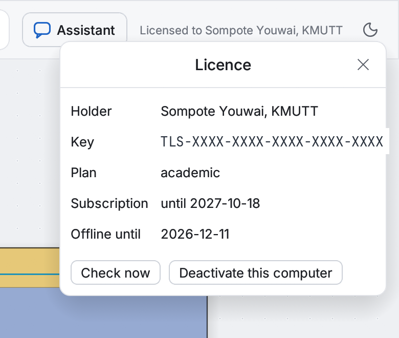

## Working offline

Activation needs the internet once. After that Tellus runs without a connection for up
to 30 days, and it checks the key with the server about every 7 days whenever it can. If
Tellus has been offline for longer than 30 days, it asks for the key again, and
connecting to the internet and clicking **Activate** restores it. When the subscription
ends or the key is withdrawn, Tellus shows the activation screen at its next check, but
your project files stay yours and open again once the licence is renewed.

## Activating from the command line

IT staff who install Tellus on many computers can activate without opening the program:

```sh
# macOS
/Applications/Tellus.app/Contents/MacOS/tellus --activate TLS-XXXX-XXXX-XXXX-XXXX-XXXX
/Applications/Tellus.app/Contents/MacOS/tellus --licence      # shows the holder, plan and expiry
/Applications/Tellus.app/Contents/MacOS/tellus --deactivate   # frees this computer's seat

# Windows (Command Prompt, in the Tellus folder)
Tellus.exe --activate TLS-XXXX-XXXX-XXXX-XXXX-XXXX
Tellus.exe --licence
Tellus.exe --deactivate
```

On Windows the result appears just after the prompt returns, because `Tellus.exe` is a
windowed program, so press **Enter** once to get a clean prompt again.

The headless MCP server for AI agents (`tellus --mcp`) uses the same licence, so it has every
feature once the computer is activated and the free edition's limits before, and [Step 4](#step-4-optional-connect-claude-or-chatgpt-through-mcp)
shows how to connect it to Claude or ChatGPT.

## When activation fails

| Message | What it means and what to do |
|---|---|
| This licence key is not known. | The key was mistyped. Paste it again from the e-mail. |
| All N seat(s) of this licence are in use. | The key is active on as many computers as it allows. Deactivate one of them, or ask for more seats. |
| This subscription expired on … | The subscription has ended. Ask to renew it, then click **Activate** again. |
| This licence key has been revoked. | The key was withdrawn. Write to tellusfem@gmail.com. |
| Cannot reach the licence server | The computer is offline, or a firewall or proxy blocks the connection. Connect to the internet and try again, or ask IT to allow the licence server (below). |
| The computer's clock is earlier than when Tellus last ran | The system date was set back. Correct the date and time. |

The licence is stored in your user folder (`~/Library/Application Support/Tellus` on
macOS and `%APPDATA%\Tellus` on Windows), so each user account on a shared computer
activates separately. The key is tied to the computer, so copying the licence file to
another computer does not work.

## For IT staff

Tellus contacts only its licence server over HTTPS (port 443), and it does so at
activation, at deactivation and for the check about every 7 days. The calculations
themselves run on the computer and send nothing over the network. The chat assistant is
the one exception, because its engines call the API providers whose keys the user enters
under **Settings**. A university or company network that filters outgoing traffic
therefore needs to allow the licence server, whose address we give on request at
[tellusfem@gmail.com](mailto:tellusfem@gmail.com), and, if the chat assistant is used, the
chosen API provider.

## Help

Write to [tellusfem@gmail.com](mailto:tellusfem@gmail.com) for a key, a renewal, more
seats, or any problem with activation. Please include the message Tellus shows and, for
activation problems, the output of `tellus --licence`, which names the computer and its
licence state.
